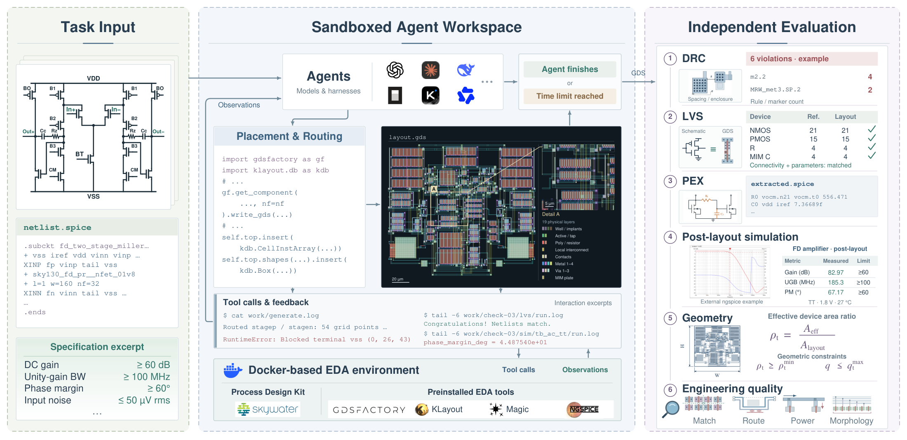
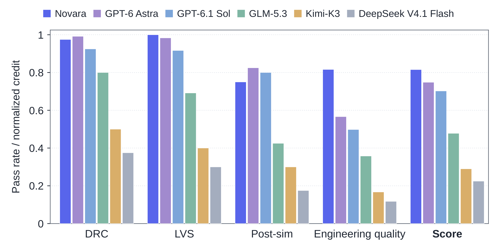
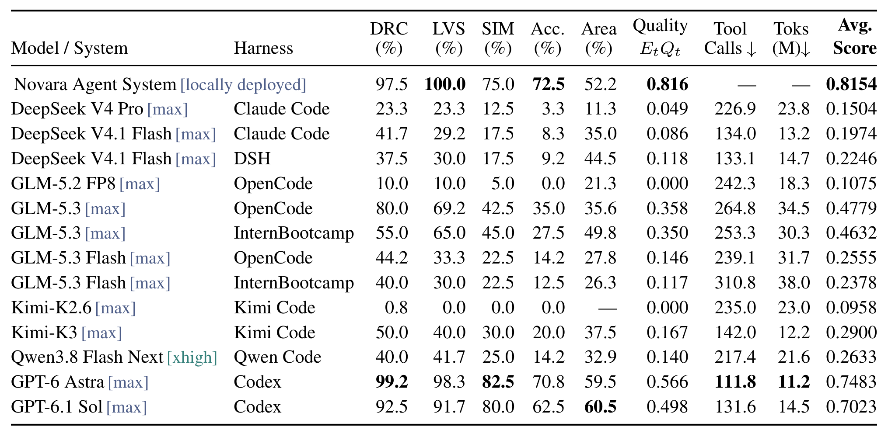

<div align="center">

# AnalogLayoutWorld

### An Open Benchmark for Agentic Analog Layout Design

arXiv, November 2026

**English** | [简体中文](README.zh-CN.md)

[Paper](https://arxiv.org/abs/2611.16991) ·
[Getting started](README.md#quick-start) ·
[Tasks](tasks) ·
[Documentation](docs/README.md)

</div>



*Overview of AnalogLayoutWorld (paper Figure 3). Agents build layouts from fixed
circuit inputs using their harness's native tools; the submitted GDS is evaluated
independently.*

AnalogLayoutWorld evaluates whether coding agents can turn **fixed transistor-level
netlists into analog circuit layouts**. Its **40 expert-reviewed SKY130 tasks**
cover amplifiers, references, power management, sampling circuits, and oscillators.

Agents use the **native tools of their chosen harness**, without a benchmark-specific
typed-tool interface or MCP server. They have broad freedom to choose how they
generate layouts, operate EDA tools, and iterate within each task's requirements.
The fully open-source EDA toolchain—gdsfactory, KLayout, Magic, Netgen, and ngspice—
lowers the barrier to reproduction; Docker supplies the tools and required PDK assets.

Independent evaluation checks DRC/LVS, parasitic extraction, post-layout electrical
behavior, compactness, and engineering quality. Each [task](tasks) includes its
circuit inputs, instructions, and testbenches. See the [paper](https://arxiv.org/abs/2611.16991)
for the benchmark and the [protocol](docs/protocol.md) for budgets and scoring.

## Quick start

You need **Git, Python 3.12+, and a Linux/amd64 Docker host with Docker Compose
v2**. The default allocation is **6 CPU / 32 GiB per concurrent task**.

### Install

```bash
git clone https://github.com/Nova-Silicon/AnalogLayoutWorld.git
cd AnalogLayoutWorld
docker info
docker compose version
python3 -m venv .venv
source .venv/bin/activate
python -m pip install -e '.[harbor]'
alw list
```

The install pins **Harbor 0.24.0**; `alw list` lists all 40 tasks. Task Dockerfiles
automatically pull the **public prebuilt EDA image, pinned by digest**.
No host EDA installation or image source build is needed.
Image downloads, harness setup, and model calls require network access.

From the repository root with `.venv` active, choose one of the following ways to run an evaluation.

### A. Use a model provider’s API

The example uses the `openai` provider for OpenAI. Replace `YOUR_API_KEY` and `YOUR_MODEL_ID` with your API key and model ID. If your provider supplies a custom API URL, use option B.

```bash
unset OPENAI_BASE_URL PROVIDER_OPTIONS
export OPENAI_API_KEY='YOUR_API_KEY'
export MODEL_ID='YOUR_MODEL_ID'

harbor trial start \
  --path tasks/sky130-adb-ota-5t-gain40-pm60-noise50uv-pvt-layout \
  --agent opencode --model "openai/${MODEL_ID}" \
  --agent-kwarg version=1.19.0 \
  --agent-timeout 600 \
  --env docker --trials-dir jobs --trial-name first-api-run
```

### B. Use a self-hosted or compatible API endpoint

Set the base URL of an OpenAI-compatible Chat Completions service reachable from the agent container, along with the API key and model ID. For a service without authentication, set `OPENAI_API_KEY` to `not-needed`.

```bash
export OPENAI_BASE_URL='http://YOUR_MODEL_HOST:8000/v1'
export OPENAI_API_KEY='YOUR_API_KEY'
export MODEL_ID='YOUR_MODEL_ID'
export PROVIDER_OPTIONS='{"provider":{"litellm_proxy":{"npm":"@ai-sdk/openai-compatible","options":{"baseURL":"{env:OPENAI_BASE_URL}","apiKey":"{env:OPENAI_API_KEY}"}}}}'

harbor trial start \
  --path tasks/sky130-adb-ota-5t-gain40-pm60-noise50uv-pvt-layout \
  --agent opencode --model "litellm_proxy/${MODEL_ID}" \
  --agent-kwarg version=1.19.0 \
  --agent-kwarg "opencode_config=${PROVIDER_OPTIONS}" \
  --agent-timeout 600 \
  --env docker --trials-dir jobs --trial-name first-url-run
```

### Inspect the first run

Set `--agent-timeout` to the number of seconds you want to give the agent. The example allows 600 seconds (10 minutes). Independent verification then runs with the task’s default limit of one hour. Find the trial record in `jobs/first-api-run/result.json` or `jobs/first-url-run/result.json`. Use a new `--trial-name` for another run.

For formal experiments, use the [full-budget commands](docs/running.md#single-task)
and [three independent attempts per task](docs/running.md#formal-evaluation).

## Paper results

We evaluated open-weight models using SGLang on an H200 cluster and closed-source GPT models through an API, so results may vary with the API or model deployment.

[](https://arxiv.org/html/2611.16991v1#S1.F2)

[](https://arxiv.org/html/2611.16991v1#S4.T1)

For more analysis, see [Section 5 of the paper](https://arxiv.org/html/2611.16991v1#S5).

## Documentation

| Next step | Guide |
|---|---|
| Run more tasks, inspect results, or verify an existing GDS | [Running guide](docs/running.md) |
| Select another harness or configure a model provider | [Harnesses and providers](docs/agents.md) |
| Understand task budgets, verification, and scoring | [Evaluation protocol](docs/protocol.md) |
| Inspect or rebuild the EDA environment | [EDA images](docs/images.md) |

All guides are collected in the [documentation index](docs/README.md).

Original project material uses Apache-2.0. Third-party tasks, PDK assets, and
software retain their licenses; ADB-derived content retains its non-commercial
condition. See [license scope](LICENSING.md) and [third-party notices](THIRD_PARTY_NOTICES.md).

## Acknowledgments

We sincerely thank the following open-source projects for their contributions to AnalogLayoutWorld:

- [Analog Design Bench](https://arxiv.org/abs/2609.33356) — Reference circuits for layout tasks.
- [LOADBench](https://arxiv.org/abs/2610.21591) — Open analog circuit data.
- [Harbor](https://github.com/harbor-framework/harbor) — Agent evaluation framework.

We also thank the [SGLang](https://github.com/sgl-project/sglang) team and the [open-source circuit and EDA communities](THIRD_PARTY_NOTICES.md).

## Citation

```bibtex
@misc{analoglayoutworld2026,
  author = {{NovaSilicon Team}},
  title = {{AnalogLayoutWorld}: An Open Benchmark for Agentic Analog Layout Design},
  year = {2026},
  eprint = {2611.16991},
  archivePrefix = {arXiv},
  primaryClass = {cs.AI},
  doi = {10.48550/arXiv.2611.16991},
  url = {https://arxiv.org/abs/2611.16991}
}
```
