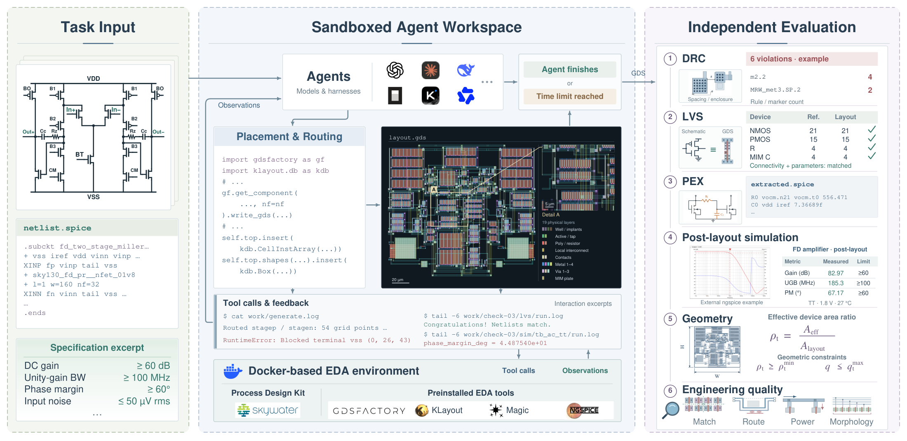
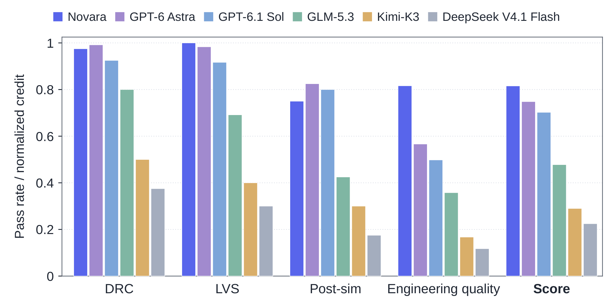
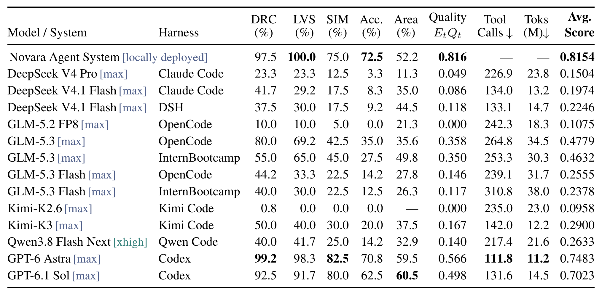

<div align="center">

# AnalogLayoutWorld

### 面向 Agent 模拟电路版图设计的开放评测基准

arXiv，2026 年 11 月

[English](README.md) | **简体中文**

[论文](https://arxiv.org/abs/2611.16991) ·
[开始使用](README.zh-CN.md#快速开始) ·
[任务](tasks) ·
[文档](docs/README.zh-CN.md)

</div>



*AnalogLayoutWorld 概览（论文图 3）。Agent 使用其 harness 的原生工具，
依据固定电路输入构建版图；提交的 GDS 随后接受独立验收。*

AnalogLayoutWorld 评估代码 Agent 能否将**固定的晶体管级网表转化为模拟电路版图**。
基准包含 **40 道经专家审阅的 SKY130 任务**，覆盖放大器、基准源、电源管理、
采样电路和振荡器。

Agent 使用**所选 harness 的原生工具**，无需基准专用的类型化工具接口或 MCP 服务。
在满足任务要求的前提下，Agent 可以自主选择版图生成方式、EDA 操作和迭代流程。
完全开源的 EDA 工具链包括 gdsfactory、KLayout、Magic、Netgen 和 ngspice，
降低了复现门槛；Docker 环境提供这些工具及所需的 PDK 资源。

独立验收涵盖 DRC/LVS、寄生参数提取、版图后仿的电气表现、紧凑程度和工程质量。
每道[任务](tasks)包含电路输入、说明和测试台。
基准介绍见[论文](https://arxiv.org/abs/2611.16991)，预算与评分规则见
[评测协议](docs/protocol.zh-CN.md)。

## 快速开始

需要 **Git、Python 3.12+，以及支持 Docker Compose v2 的 Linux/amd64 Docker 主机**。
默认资源是**每个并行任务 6 CPU / 32 GiB 内存**。

### 安装

```bash
git clone https://github.com/Nova-Silicon/AnalogLayoutWorld.git
cd AnalogLayoutWorld
docker info
docker compose version
python3 -m venv .venv
source .venv/bin/activate
python -m pip install -e '.[harbor]'
alw list
```

上述安装将 **Harbor 固定为 0.24.0**；`alw list` 将列出全部 40 道任务。
任务 Dockerfile 会自动拉取**通过 digest 固定版本的公开预构建 EDA 镜像**。
无需在主机上安装 EDA 工具或从源码构建镜像。
下载镜像、安装 harness 和调用模型服务均需要网络访问。

在仓库根目录保持 `.venv` 已激活，选择以下一种方式运行评测。

### A. 使用服务商 API

下面以 OpenAI 的 `openai` provider 为例。将 `YOUR_API_KEY` 和 `YOUR_MODEL_ID` 换成你的 API key 和模型 ID。如果服务商提供自定义 API 地址，使用方式 B。

```bash
unset OPENAI_BASE_URL PROVIDER_OPTIONS
export OPENAI_API_KEY='YOUR_API_KEY'
export MODEL_ID='YOUR_MODEL_ID'

harbor trial start \
  --path tasks/sky130-adb-ota-5t-gain40-pm60-noise50uv-pvt-layout \
  --agent opencode --model "openai/${MODEL_ID}" \
  --agent-kwarg version=1.19.0 \
  --agent-timeout 600 \
  --env docker --trials-dir jobs --trial-name first-api-run
```

### B. 使用自部署或其他兼容服务的 API 地址

填写 Agent 容器可访问的 OpenAI 兼容 Chat Completions 服务地址、API key 和模型 ID。服务未启用鉴权时，可将 `OPENAI_API_KEY` 设为 `not-needed`。

```bash
export OPENAI_BASE_URL='http://YOUR_MODEL_HOST:8000/v1'
export OPENAI_API_KEY='YOUR_API_KEY'
export MODEL_ID='YOUR_MODEL_ID'
export PROVIDER_OPTIONS='{"provider":{"litellm_proxy":{"npm":"@ai-sdk/openai-compatible","options":{"baseURL":"{env:OPENAI_BASE_URL}","apiKey":"{env:OPENAI_API_KEY}"}}}}'

harbor trial start \
  --path tasks/sky130-adb-ota-5t-gain40-pm60-noise50uv-pvt-layout \
  --agent opencode --model "litellm_proxy/${MODEL_ID}" \
  --agent-kwarg version=1.19.0 \
  --agent-kwarg "opencode_config=${PROVIDER_OPTIONS}" \
  --agent-timeout 600 \
  --env docker --trials-dir jobs --trial-name first-url-run
```

### 查看首次运行结果

将 `--agent-timeout 600` 中的秒数改为你希望给 Agent 的时间。示例给 Agent 10 分钟，随后独立验收按任务默认设置运行，最多 1 小时。单次运行记录保存在 `jobs/first-api-run/result.json` 或 `jobs/first-url-run/result.json`。再次运行时请换一个 `--trial-name`。

正式评测请使用[完整预算的启动命令](docs/running.zh-CN.md#single-task)，并配置[每题三次独立尝试](docs/running.zh-CN.md#formal-evaluation)。

## 论文结果

我们在 H200 集群上使用 SGLang 部署开源模型进行评测，通过 API 评测闭源 GPT 模型，实际复现结果可能因 API 或模型部署方式不同而有所差异。

[](https://arxiv.org/html/2611.16991v1#S1.F2)

[](https://arxiv.org/html/2611.16991v1#S4.T1)

更多实验分析见[论文第 5 节](https://arxiv.org/html/2611.16991v1#S5)。

## 文档

| 后续需求 | 指南 |
|---|---|
| 运行更多任务、查看结果或验收已有 GDS | [运行指南](docs/running.zh-CN.md) |
| 选择其他 harness 或配置模型 provider | [Harness 与模型服务](docs/agents.zh-CN.md) |
| 了解任务预算、验收和评分 | [评测协议](docs/protocol.zh-CN.md) |
| 查看或重建 EDA 环境 | [EDA 镜像](docs/images.zh-CN.md) |

全部指南汇总于[文档索引](docs/README.zh-CN.md)。

项目原创内容采用 Apache-2.0。第三方任务、PDK 资源和软件保留各自许可；
ADB 衍生内容保留非商业限制。请阅读[许可范围](LICENSING.md)和
[第三方声明](THIRD_PARTY_NOTICES.md)。

## 致谢

我们衷心感谢以下开源项目对 AnalogLayoutWorld 的支持：

- [Analog Design Bench](https://arxiv.org/abs/2609.33356) — 为版图任务提供参考电路。
- [LOADBench](https://arxiv.org/abs/2610.21591) — 开放模拟电路数据。
- [Harbor](https://github.com/harbor-framework/harbor) — 提供 Agent 评测框架。

也感谢 [SGLang](https://github.com/sgl-project/sglang) 团队和[开源电路与 EDA 社区](THIRD_PARTY_NOTICES.md)。

## 引用

```bibtex
@misc{analoglayoutworld2026,
  author = {{NovaSilicon Team}},
  title = {{AnalogLayoutWorld}: An Open Benchmark for Agentic Analog Layout Design},
  year = {2026},
  eprint = {2611.16991},
  archivePrefix = {arXiv},
  primaryClass = {cs.AI},
  doi = {10.48550/arXiv.2611.16991},
  url = {https://arxiv.org/abs/2611.16991}
}
```
